# Evidence

Back to [README](README.md). This file is the single place where the screenshots live with what each
one proves: monitoring and observability (Fleet Overview, metrics, traces, logs and alerts), static
application security testing (SAST) and software composition analysis (SCA). Every image was opened
and read before it was kept, and the caption under it says what the picture shows, not what it was
meant to show.

Captured on 2026-10-13 at commit `d538b32` (`git rev-parse --short HEAD`), on one laptop, with
uncommitted changes in the working tree (the refreshed images themselves). Times are South African
Standard Time, 2 hours ahead of Coordinated Universal Time (UTC). The one exception is
[Ledger outage over gRPC](#ledger-outage-over-grpc-2026-10-14), captured on 2026-10-14 at `3b92e9d`, and
[Service discovery](#service-discovery-eureka-on-kind-2026-10-16), captured on 2026-10-16 at `8fd3c12`.

How to reproduce each section:

| Section | Command | Detail |
|---|---|---|
| Monitoring and observability | `REDIS_PORT=6390 ./fleet.sh up`, then `cd docs/observability/verification && npm install && node 2026-10-13-dashboards-playwright.mjs` | [docs/observability.md](docs/observability.md#verifying-the-dashboards-playwright); the run log is [2026-10-13-dashboards-playwright-run.log](docs/observability/verification/2026-10-13-dashboards-playwright-run.log). The suite made 12 of the 15 monitoring images. The other 3 come from two small Playwright scripts beside it, run the same way: `alerts-rule-list.png` and `alerts-state-history.png` from [2026-10-13-alert-pages-capture.mjs](docs/observability/verification/2026-10-13-alert-pages-capture.mjs) (opens each page, waits 7 s), and `traces-service-map.png` from [2026-10-13-service-map-capture.mjs](docs/observability/verification/2026-10-13-service-map-capture.mjs) (scrolls to the Service map, clicks its zoom-out button once) |
| Service discovery | `./k8s/kube.sh up`, the socat bridge below, then `cd docs/observability/verification && node 2026-10-16-eureka-capture.mjs` | [2026-10-16-eureka-capture.mjs](docs/observability/verification/2026-10-16-eureka-capture.mjs) reads the registry table, fails unless it holds exactly gateway-svc, ledger-svc and conversion-svc at `UP (2)` each, and takes the image |
| SAST | `./gradlew --no-build-cache --rerun-tasks clean build` | [docs/quality-gates.md](docs/quality-gates.md); result lines in [2026-10-13-gate-summary.log](docs/evidence/security/2026-10-13-gate-summary.log) |
| SCA | `./gradlew bootBuildImageAll checkSupplyChain` | [docs/supply-chain.md](docs/supply-chain.md); console in [2026-10-13-supply-chain-console.txt](docs/evidence/security/2026-10-13-supply-chain-console.txt), exit codes in [2026-10-13-supply-chain-status.txt](docs/evidence/security/2026-10-13-supply-chain-status.txt) |
| SAST and SCA images | from `docs/observability/verification` run `node ../../evidence/security/2026-10-13-capture.mjs <repo root> ledger-svc` | [2026-10-13-capture.mjs](docs/evidence/security/2026-10-13-capture.mjs) copies only the four HTML report directories it renders into a temporary directory, serves that on 127.0.0.1 (never the repository root, which holds `.env` and `.git`), and writes the images to `docs/evidence/security/` |

Contents: [Monitoring and observability](#monitoring-and-observability) ([Fleet Overview](#fleet-overview) ·
[Metrics](#metrics) · [Traces](#traces) · [Logs](#logs) · [Alerts](#alerts) ·
[Ledger outage over gRPC](#ledger-outage-over-grpc-2026-10-14)) ·
[Service discovery](#service-discovery-eureka-on-kind-2026-10-16) ·
[SAST](#static-application-security-testing-sast) · [SCA](#software-composition-analysis-sca) ·
[What this evidence does not prove](#what-this-evidence-does-not-prove)

## Monitoring and observability

The fleet ran one Java virtual machine (JVM) per service, with Grafana 13.2.3 in
`grafana/otel-lgtm:0.36.0`. The currencies are the South African rand (ZAR), Kenyan shilling (KES)
and Nigerian naira (NGN), against the stablecoins Tether (USDT) and United States dollar coin (USDC).
The Playwright suite drove two traffic runs, at about 21:04 and 21:10, which is why most rate panels
show two spikes. The passing run started 21:10:07 and ended 21:18:58: 65 checks passed, 0 failed,
exit 0. Its traffic, from the run log's first line and
[traffic.mjs](docs/observability/verification/traffic.mjs): 4 deposits (each replayed once) and 1
refused; 3 quotes and 3 conversions on each of four currency pairs (ZAR/USDT, ZAR/USDC, NGN/USDT,
KES/USDC), so 12 completed; one probe quote and conversion on ZAR/USDT (the traced one), so 13
completed in all; an unsupported ZAR/NGN quote; one oversized KES/USDT quote whose conversion was
refused for insufficient funds; a stale-rate USDT/ZAR quote refused with 502; and a burst of 180
balance reads on one merchant (102 answered 200, 78 answered 429).

| Fact | Number | Universe | Command |
|---|---|---|---|
| Fleet health | 15 of 15 checks passed | `fleet.sh` checks, at `up` and again at the end | `REDIS_PORT=6390 ./fleet.sh status` |
| Suite | 65 passed, 0 failed, exit 0 | the 2026-10-13 suite, one run | `node 2026-10-13-dashboards-playwright.mjs` |
| Metric identity | 1 instance series per JVM | all 5 jobs | `count by (job) (group by (job, instance) (present_over_time(jvm_threads_live[30s])))` |
| Log to trace correlation | 20 of 20 resolved to their span | 20 drawn at random from 277 lines with a `trace_id` in the last 10 minutes | suite check |
| Content floor | fleet 19 panels 0 empty; money 13 panels 1 empty; traces 6 panels 0 empty; logs 3 panels 0 empty; alerts 11 panels 2 empty | desktop, every board scrolled | suite check |
| Time picker | 1800 s to 300 s on every board | fleet 14, money 17, traces 9, logs 6, alerts 6 datasource requests | suite check |
| Provisioned alert rules | 9 | Grafana provisioning application programming interface (API) | `curl -s http://localhost:3000/api/v1/provisioning/alert-rules` |

Sources: the suite, metric identity, correlation, content floor and time picker rows, and the 4
alert annotations, are in the committed
[run log](docs/observability/verification/2026-10-13-dashboards-playwright-run.log). The 9 provisioned
rules and their holds are in `docker/lgtm/alerting/rules.yaml` as committed at `d538b32`
(`git show d538b32:docker/lgtm/alerting/rules.yaml`). The 15 of 15 fleet checks at `up` are in
[2026-10-13-fleet-up-before-capture.log](docs/observability/verification/2026-10-13-fleet-up-before-capture.log), and the
crashed first run (exit 1 after 6 checks) in
[2026-10-13-dashboards-playwright-run1-crashed.log](docs/observability/verification/2026-10-13-dashboards-playwright-run1-crashed.log). These numbers have **no committed source**, because they
were read from terminal output or a live system that was not saved to the repository: the start time 21:10:07, the end time
21:18:58 (the run log's modification time when it was written; a checkout has since reset it), the
provisioning API's live answer of 9 rules, the lgtm recreate at 21:03:51 (the state-history image
shows provisioning at 21:03:53), the Alerts to Slack timings and counter, the 32 of 173 trace ids of the crashed first run, and trace
`1da752b225ab41c41cb44000e260f031`.

### Fleet Overview

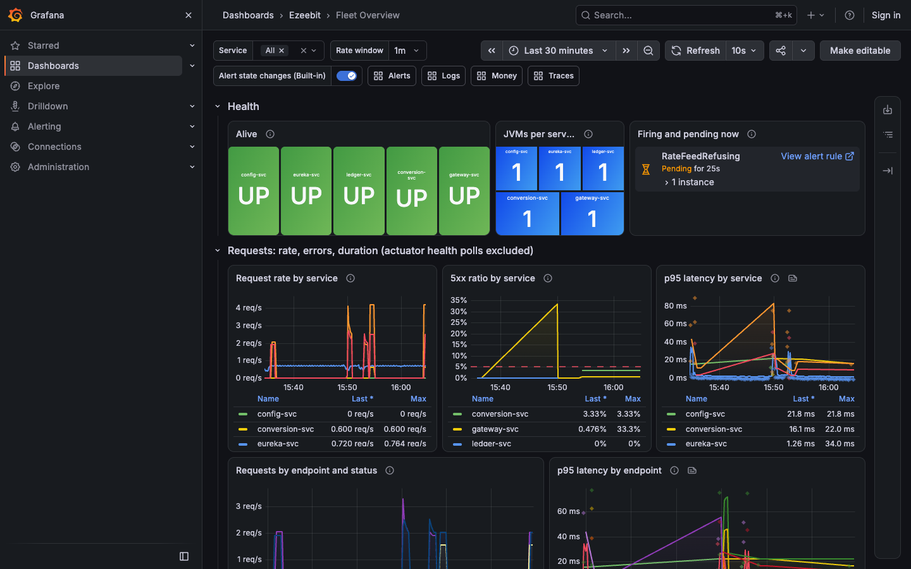

Fleet Overview, last 30 minutes, at 1440 by 900. The Alive tiles show `UP` for config-svc, gateway-svc,
conversion-svc, ledger-svc and eureka-svc, and JVMs per service is 1 for each. "Firing and pending now"
lists RateFeedRefusing Pending for 28 s. Request rate: conversion-svc 0.600 req/s, eureka-svc 0.660
req/s. 5xx ratio: conversion-svc 3.33%, gateway-svc 0.476%, both spiking at about 21:10. p95 latency:
conversion-svc 41.9 ms, eureka-svc 1.98 ms, with exemplar diamonds. Captured 21:10:57 at
`/d/ezeebit-fleet?from=now-30m&to=now`.

**Proves** every service is up and exports as exactly one JVM series, and per-service rate, errors and
duration (RED) render from live traffic with exemplars. The 3.33% 5xx on conversion-svc is the suite's
deliberate stale-rate quote (502 `RATE_REJECTED`), and that same quote holds RateFeedRefusing in
Pending.

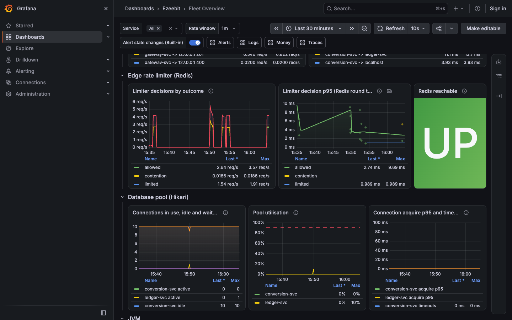

The edge rate limiter row. "Limiter decisions by outcome" stacks its series (stacking `normal` in
`docker/lgtm/dashboards/fleet-overview.json`), so the top line, drawn in red and peaking near 4.7
req/s at about 21:04 and 21:10, is the stacked total; its own legend row is below the panel's frame.
Legend rows in frame: allowed 2.64 req/s (max 3.00), contention 0, limited 1.56 req/s (max 1.63).
Limiter decision p95 (the Redis round trip): allowed 2.75 ms
(max 11.6), limited 0.975 ms, with exemplars. Redis reachable reads `UP`. The Hikari database pool row:
0 active connections on conversion-svc and ledger-svc, 10 idle on conversion-svc, utilisation 0%
against a dashed 90% line, acquire p95 and timeouts 0 ms. Same board, scrolled inside Grafana's pane,
21:11:02.

**Proves** the limiter records allowed and limited decisions during the 180-request burst, the Redis
round trip is timed with exemplars, Redis is reachable, and the Hikari pools are idle with no waiters
and no timeouts.

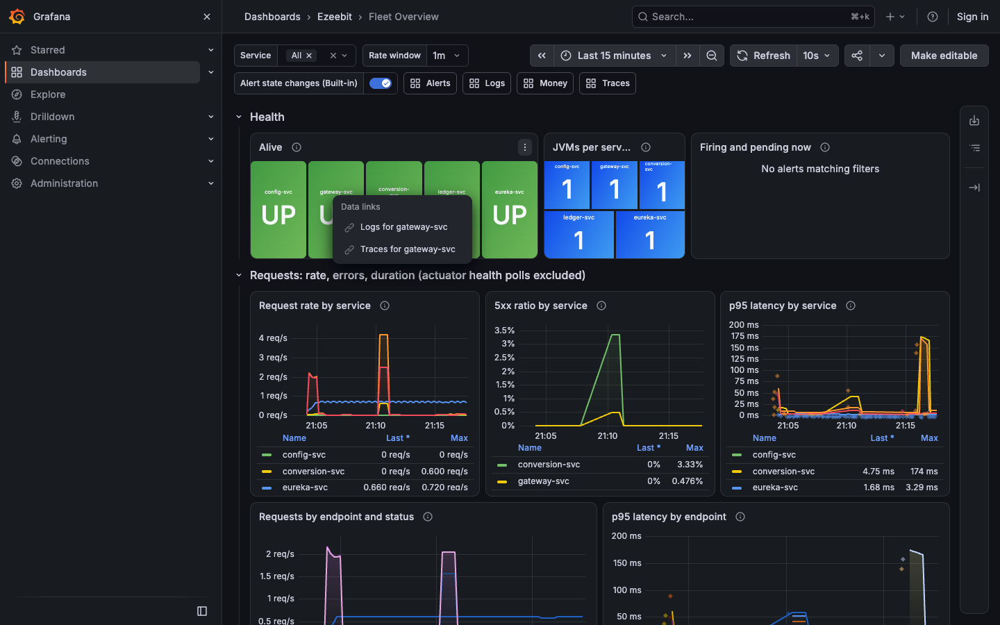

Fleet Overview at the last 15 minutes with the gateway-svc Alive tile clicked: a "Data links" menu
offers "Logs for gateway-svc" and "Traces for gateway-svc". "Firing and pending now" reads "No alerts
matching filters". Captured 21:17:55.

**Proves** a tile carries per-service links. The suite clicked "Logs for gateway-svc" and landed on
`/d/ezeebit-logs/logs?var-service=gateway-svc&from=now-15m&to=now`, where 2 expressions carried
`gateway-svc` (checks "data link lands on Logs for the service, window kept" and "the landed Logs
board queries that service").

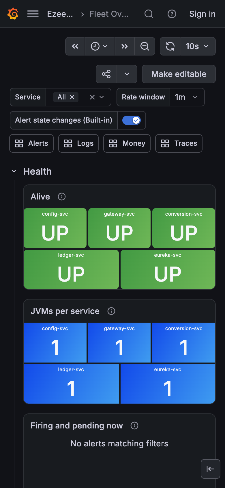

Fleet Overview at 390 px wide (device scale 2). The controls wrap onto several lines, the Alive tiles
reflow to 3 plus 2, all `UP`, JVMs per service is 1 for all five, and nothing is cut off horizontally.
Captured 21:12:07.

**Proves** the board reads at phone width. At this width Grafana scrolls the document rather than its
own pane, and the suite took 9 viewport captures of it, each scroll step moved (run log line 25).

### Metrics

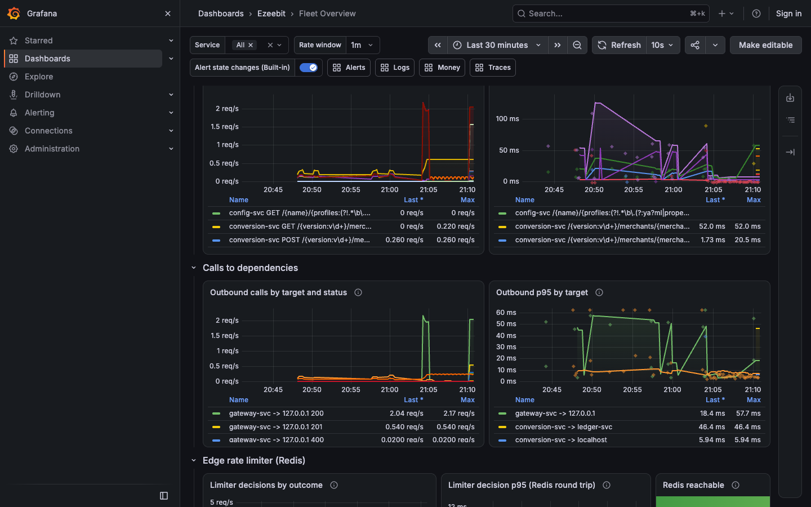

Fleet Overview scrolled to the Hypertext Transfer Protocol (HTTP) metrics. Requests by endpoint and
status: conversion-svc `POST` 0.260 req/s, conversion-svc `GET` 0 req/s (max 0.220). p95 latency by
endpoint: conversion-svc endpoints at 52.0 ms and 1.73 ms, with exemplars. Outbound calls by target
and status: gateway-svc to 127.0.0.1 at 200 2.04 req/s, at 201 0.540 req/s, at 400 0.0200 req/s.
Outbound p95 by target: gateway-svc to 127.0.0.1 18.4 ms, conversion-svc to ledger-svc 46.4 ms,
conversion-svc to localhost 5.94 ms. Captured 21:10:59.

**Proves** server metrics break down by templated endpoint and status, and client-side outbound calls
are measured per target with p95 latency and exemplars: a per-endpoint view beyond the per-service RED
panels.

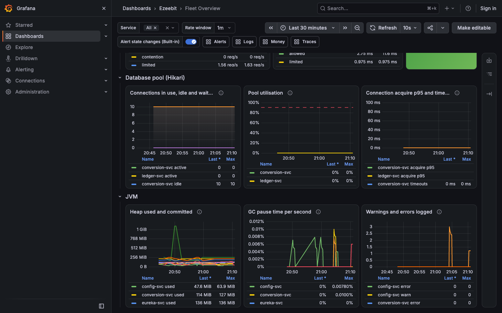

Fleet Overview scrolled to the database pool and JVM rows. Heap used: config-svc 47.6 MiB,
conversion-svc 114 MiB, eureka-svc 136 MiB, with a spike near 1 GiB at about 20:52. Garbage-collection
pause time per second: config-svc max 0.00780%, conversion-svc max 0.0100%, eureka-svc 0%. Warnings
and errors logged peak at about 3 near 21:04. Captured 21:11:05.

**Proves** JVM runtime metrics (heap, garbage-collection pause, logged warnings and errors) and
connection-pool metrics are exported per service and plotted. These two images come from the Fleet
Overview board: none of the five Ezeebit dashboards is metrics-only (the lgtm image also ships
generic JVM and RED boards, which this project does not use).

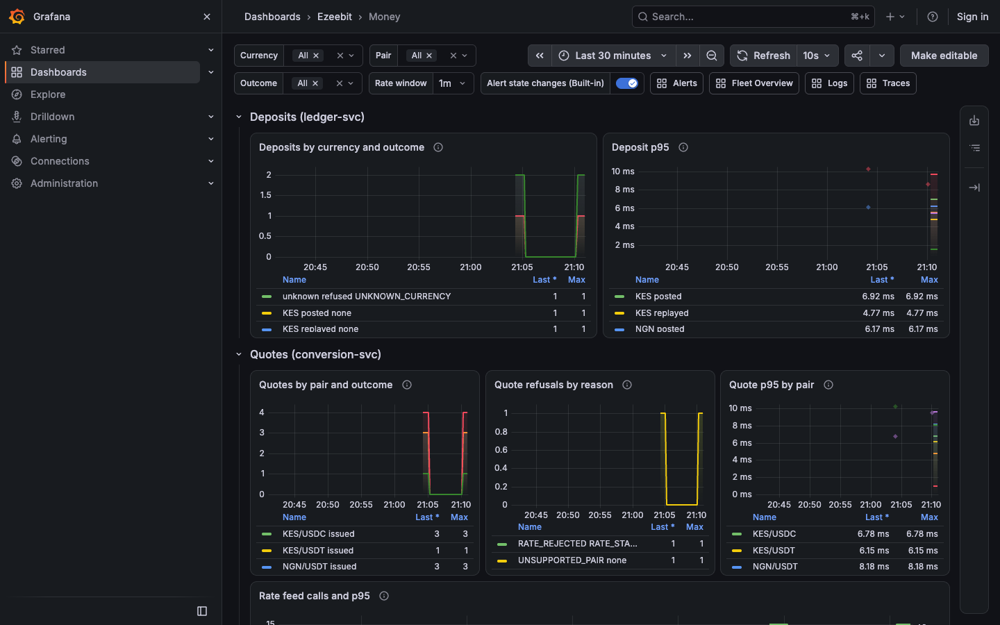

The Money board, last 30 minutes. Deposits by currency and outcome: "unknown refused
UNKNOWN_CURRENCY" 1, "KES posted none" 1, "KES replayed none" 1. Deposit p95: KES posted 6.92 ms, KES
replayed 4.77 ms, NGN posted 6.17 ms, with exemplars. Quotes issued: KES/USDC 3, KES/USDT 1, NGN/USDT
3. Quote refusals by reason: `RATE_REJECTED` 1 and `UNSUPPORTED_PAIR` 1. Quote p95: KES/USDC 6.78 ms,
KES/USDT 6.15 ms, NGN/USDT 8.18 ms. Captured 21:11:14 at `/d/ezeebit-money?from=now-30m&to=now`.

**Proves** business counters by currency, pair and outcome, and refusals by code, all with bounded tags:
a refused deposit's currency is `unknown`, never the caller's text. The two traffic runs show as two
spikes in each rate window.

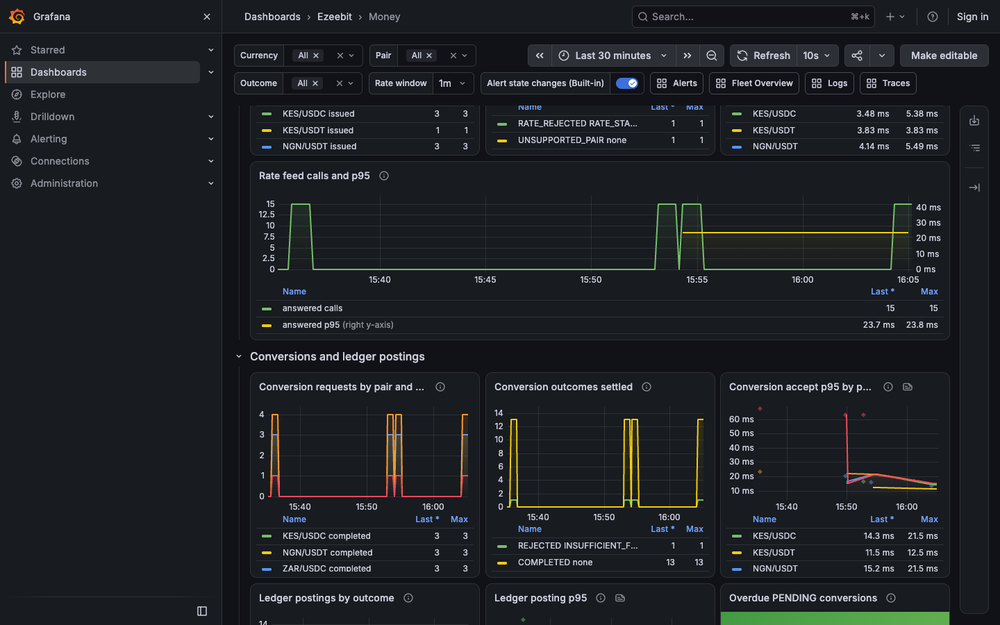

The Money board scrolled. Rate feed: 15 answered calls, answered p95 23.7 ms on the right axis.
Conversion requests: KES/USDC, NGN/USDT and ZAR/USDC completed 3 each. Conversion outcomes settled:
`COMPLETED` 13 and `REJECTED INSUFFICIENT_FUNDS` 1. Conversion accept p95: KES/USDC 32.7 ms, KES/USDT
15.9 ms, NGN/USDT 22.0 ms. Captured 21:11:17.

**Proves** conversions are counted by pair and outcome from the `conversion accept` span, settled
outcomes show completed and rejected for funds, and the rate feed shows its call count against its p95.

### Traces

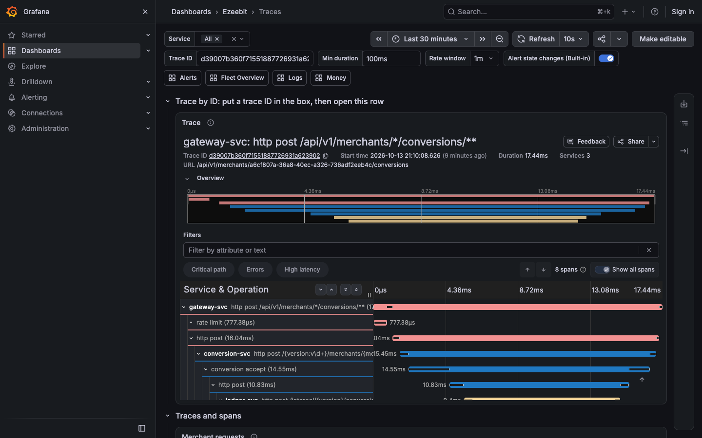

The Traces board with the `Trace by ID` row open for trace `d39007b360f71551887726931a623902`:
"gateway-svc: http post /api/v1/merchants/*/conversions/**", start 21:10:08.626, duration 17.44 ms,
Services 3, 8 spans. The span tree runs gateway-svc request, `rate limit` (777.38 µs), http post
(16.04 ms), conversion-svc http post (15.45 ms), `conversion accept` (14.55 ms), http post (10.83 ms),
then ledger-svc, whose row is cut at the bottom of the frame (its bars show in the overview). Captured
21:18:51.

**Proves** one merchant conversion is one trace across gateway-svc, conversion-svc and ledger-svc,
with the business spans `rate limit` and `conversion accept` in frame. The third business span,
`ledger posting`, is below the frame: the suite check "business span 'ledger posting' in the trace"
(run log line 6) confirms it, not the picture. The suite check "trace view shows spans from three
services" found all three names rendered, and the trace's 8 spans come from those 3 services.

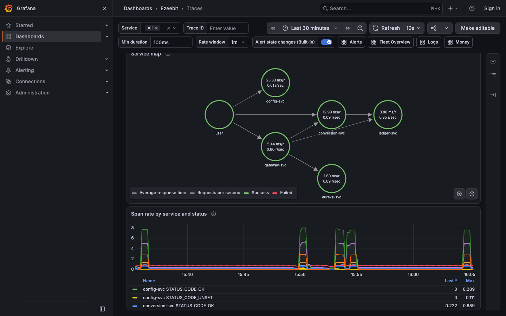

The Traces board's Service map after one zoom-out click. Six nodes: user; gateway-svc 6.41 ms/r;
conversion-svc 14.49 ms/r; ledger-svc 4.60 ms/r; config-svc 6.05 ms/r; eureka-svc 1.24 ms/r. Edges run
user to gateway-svc, config-svc, eureka-svc and conversion-svc; gateway-svc to eureka-svc,
conversion-svc and ledger-svc; conversion-svc to ledger-svc. Every node ring is green. Below it, span
rate by service and status spikes at 21:04 and 21:10. Captured 21:22:45 by a separate committed script, [2026-10-13-service-map-capture.mjs](docs/observability/verification/2026-10-13-service-map-capture.mjs), not the suite.

**Proves** Tempo derives the call graph from spans (gateway to conversion and ledger, conversion to
ledger), and its span metrics give rates and status per service as a cross-check on the services' own
counters.

Not pictured, measured by the suite: latency exemplars carry a trace id that Tempo resolves
(`ffe22bb056267a9ca717e8413766a7c8`). Measured earlier the same day: with Postgres stopped under a
deposit, the `deposit` span and the request span both carry `TransactionSystemException: JDBC rollback
failed` with status error (trace `1da752b225ab41c41cb44000e260f031`).

Over gRPC (2026-10-14): one demo conversion is one trace, `f9b98a426a168f23f9bbc22fdce2f5e2`, in which the ledger-svc gRPC server span `ConversionPostings/Post` is the child of conversion-svc's gRPC client span; commands and every span in [the gRPC trace check](docs/observability/verification/2026-10-14-grpc-trace.md).

### Logs

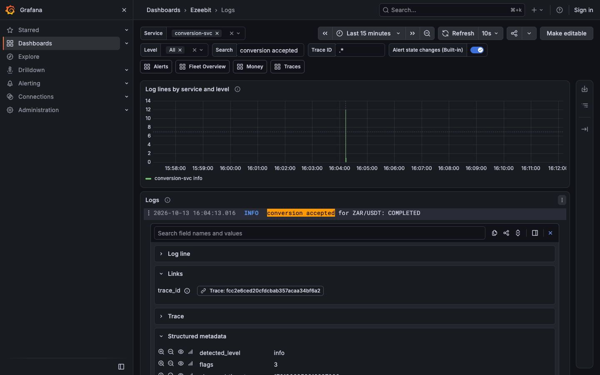

The Logs board filtered to conversion-svc and "conversion accepted", last 15 minutes. The line
`2026-10-13 21:10:08.642 INFO conversion accepted for ZAR/USDT: COMPLETED` is expanded, and its Links
section shows `Trace: d39007b360f71551887726931a623902`. Captured 21:18:21.

**Proves** a log line written inside a request carries its trace id: the same trace the trace view shows
across three services. Loki's derived field turns it into a link.

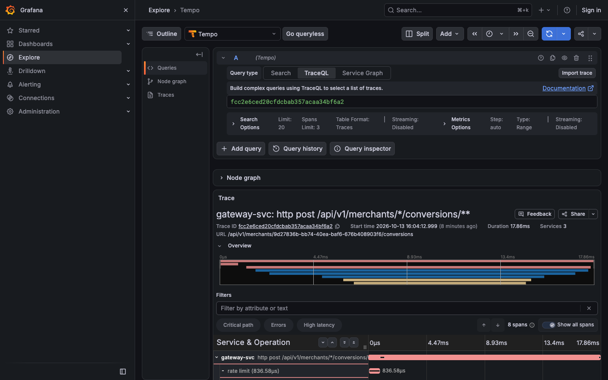

Explore on Tempo with a TraceQL query for `d39007b360f71551887726931a623902`. The rendered trace is the
same gateway-svc conversion: start 21:10:08.626, 17.44 ms, 3 services, 8 spans. Captured 21:18:36.

**Proves** clicking the log line's trace link opens Explore on Tempo with that trace id and renders the
trace. Suite checks "trace_id opens the trace in Tempo" and "the opened trace shows its services"
passed.

### Alerts

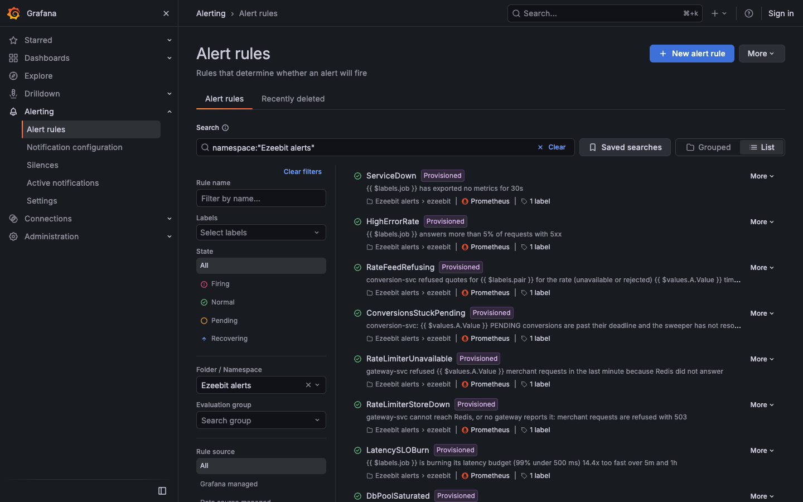

Alerting, Alert rules, list view filtered to the "Ezeebit alerts" folder. Each visible rule is Normal,
Provisioned, on the Prometheus datasource: ServiceDown ("{{ $labels.job }} has exported no metrics for
30s"), HighErrorRate, RateFeedRefusing, ConversionsStuckPending, RateLimiterUnavailable,
RateLimiterStoreDown, LatencySLOBurn and DbPoolSaturated (cut at the bottom). The ninth,
LedgerInvariantBroken, is below the fold. Captured 21:20:54 by a separate committed script,
[2026-10-13-alert-pages-capture.mjs](docs/observability/verification/2026-10-13-alert-pages-capture.mjs), not the suite.

**Proves** the provisioned rules load and evaluate, and each summary names its service or pair. The
provisioning API lists 9 rules, with holds of 1m (ServiceDown, RateLimiterUnavailable,
RateLimiterStoreDown, DbPoolSaturated), 2m (HighErrorRate, RateFeedRefusing, LatencySLOBurn), 5m
(ConversionsStuckPending) and 0s (LedgerInvariantBroken).

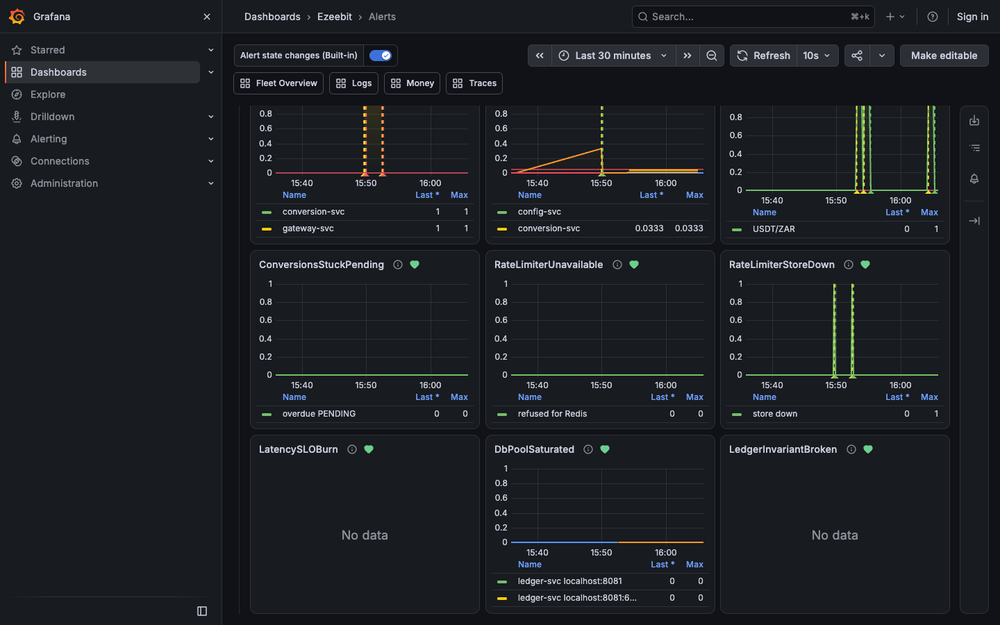

The Alerts board's rule-input grid, scrolled so the top row's titles are out of view. By the board's
layout in `docker/lgtm/dashboards/alerts.json`, the top row is ServiceDown (left), HighErrorRate
(middle) and RateFeedRefusing (right). ServiceDown: config-svc and conversion-svc at 1 from 20:45 to
about 21:03. HighErrorRate: conversion-svc max 0.0333. RateFeedRefusing: USDT/ZAR max 1, with two
dashed annotation pairs at about 21:04 and 21:10. RateLimiterStoreDown: "store down" flapping between
1 and 0 from 20:45 to about 21:03, then 0. ConversionsStuckPending and RateLimiterUnavailable at 0.
DbPoolSaturated: two ledger-svc series at 0. LatencySLOBurn and LedgerInvariantBroken: No data.
Captured 21:11:58.

The 20:45 to 21:03 inputs, and the heap spike at about 20:52 on the JVM row, are consistent with the
`fleet.sh` sweep test, which deliberately stops and starts the fleet: it stops wiremock, kills
ledger-svc, bounces the whole stack and stops it. The log of that run is the version of
[2026-10-13-fleet-sweep-run.log](docs/fleet/verification/2026-10-13-fleet-sweep-run.log) committed in
`d538b32` (`git show d538b32:docs/fleet/verification/2026-10-13-fleet-sweep-run.log`), which starts at
2026-10-13T18:51:44Z (20:51:44 here); an earlier run of the same sweep, whose log is not committed,
preceded it that evening. The working copy of that file is a later run: it was overwritten twice the
same evening and now starts at 2026-10-13T20:45:29Z (22:45:29 here, commit `1b7053f`, after every
screenshot), so it cannot explain these inputs. The committed log does not timestamp each
case, so it cannot place every flap.

**Proves** each rule's expression is plotted against its threshold, with state changes as annotations.
RateFeedRefusing went Pending at each stale-rate quote and back to Normal; Grafana stores 4 alert
annotations, all for RateFeedRefusing, states Normal and Pending. DbPoolSaturated shows ledger-svc's old
and new JVM as two series across the 21:03 restart.

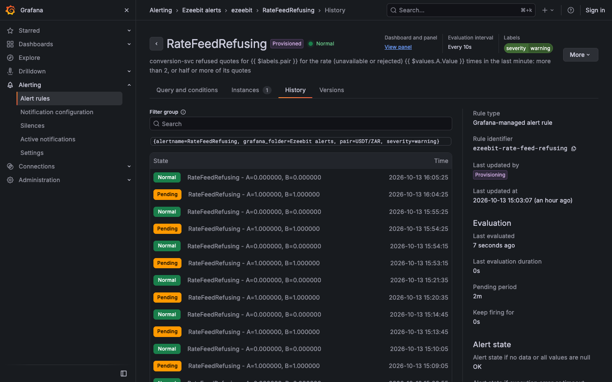

The RateFeedRefusing rule (evaluated every 10 s, severity warning, pending period 2m) on its History
tab for pair USDT/ZAR: Pending at 21:04:25 (A=1), Normal at 21:05:25 (A=0), Pending at 21:10:25 (A=1),
Normal at 21:11:25 (A=0). Captured 21:21:01 by a separate committed script,
[2026-10-13-alert-pages-capture.mjs](docs/observability/verification/2026-10-13-alert-pages-capture.mjs), not the suite.

**Proves** Grafana keeps state history for the rule, with the value of A at each transition. One
stale-rate refusal holds the rule Pending for 1 minute, less than its 2-minute hold, so it does not
fire.

#### Alerts to Slack

The second of two rehearsed outages on 2026-10-13 with `SLACK_WEBHOOK_URL` set (the first is in
[docs/observability.md](docs/observability.md#rehearsals-local-2026-10-13)): conversion-svc was stopped
with `kill`, left down until ServiceDown fired, then started again. State was polled every 5 seconds
from Grafana's rules API (`/api/prometheus/grafana/api/v1/rules`), so each time is accurate to 5
seconds.

| Event | Time |
|---|---|
| conversion-svc stopped (16:23:01) | t+0s |
| `ServiceDown{job="conversion-svc"}` Pending | t+50s |
| Alerting, page sent to Slack | t+111s |
| conversion-svc restarted | t+151s |
| Normal, all-clear sent to Slack | t+181s |

Delivery is read from Grafana's own notifier counter rather than from a log line:
`grafana_alerting_notifications_total{integration="slack"}` read **2** after the rehearsal (the page
and the all-clear), and no `grafana_alerting_notifications_failed_total` series existed, so no delivery
failed. That rehearsal's state history no longer exists in Grafana: `fleet.sh up` recreated the lgtm
container at 21:03:51, and Grafana's own database is on a tmpfs mount (`compose.yaml`), so the
recreate wiped it.

The channel itself, `#ezeebit-alerts` in the team's Slack workspace
(<https://app.slack.com/client/TUKERT8JU/C0C8MUVLZHC>), captured on 2026-10-16 with the Claude in Chrome
extension in the already signed-in Chrome session (no new sign-in), message pane only:

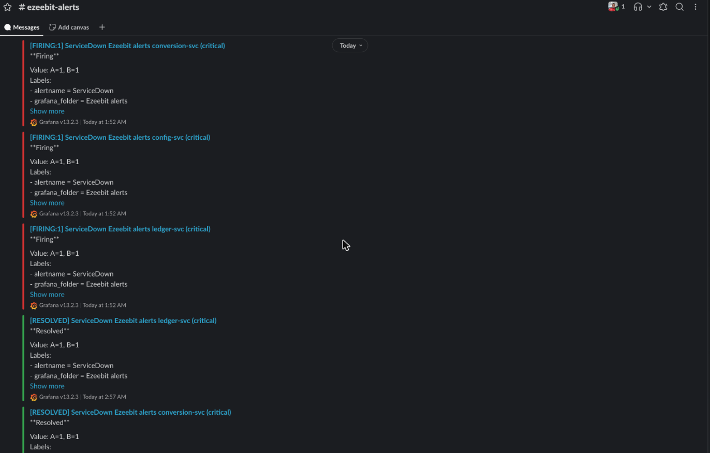

**Proves** a human-facing delivery end to end, both directions: Grafana v13.2.3 posted
`[FIRING:1] ServiceDown Ezeebit alerts conversion-svc (critical)`, and the same for config-svc and
ledger-svc, at 01:52, then `[RESOLVED] ServiceDown Ezeebit alerts ledger-svc (critical)` at 02:57 (and
conversion-svc below it), each with `alertname = ServiceDown` and `grafana_folder = Ezeebit alerts`.
Slack shows those times in the viewer's local time zone. What took the three services down that
night was not recorded: no commit, log or doc of this repository describes it.
To recapture: with the Claude in Chrome extension connected to the signed-in browser, open the channel
URL above and screenshot the message pane. Never point Playwright or any DevTools launch at the
everyday Chrome profile: its mock keychain signs Chrome out and drops account extensions.

### Ledger outage over gRPC (2026-10-14)

A rehearsed outage of the conversion-to-ledger gRPC seam, with `SLACK_WEBHOOK_URL` set: ledger-svc
killed with `kill -9` at 12:00:04 UTC, five fresh merchants then quoted and converted 50.00 ZAR each,
and `./fleet.sh up` restored the fleet. Alert states were polled every 2 s from Grafana's alerts API.
Every query, the dead-letter records and the chaos audit are in
[2026-10-14-ledger-grpc-outage.md](docs/observability/verification/2026-10-14-ledger-grpc-outage.md);
the images were taken during the outage by
[2026-10-14-ledger-grpc-capture.mjs](docs/observability/verification/2026-10-14-ledger-grpc-capture.mjs)
at 1440 x 900. The panels show local time (UTC+2), so 14:00 on them is 12:00 UTC.

| Event | Time |
|---|---|
| ledger-svc killed (12:00:04 UTC) | t+0s |
| 5 conversions answered 202 PENDING; 5 `POST` dead letters written | t+1s to t+4s |
| `ConversionLedgerDeadLettered{op="POST",reason="RETRIES_EXHAUSTED"}` Alerting (`for: 0s`, no Pending stage) | t+16s |
| Page delivered to Slack (`grafana_alerting_notifications_total{integration="slack"}` absent to 1) | t+27s |
| `ServiceDown{job="ledger-svc"}` Pending, then Alerting | t+35s, t+95s |
| `FIND` breaker open (`reason="CIRCUIT_OPEN"` Alerting) | t+166s |
| `./fleet.sh up` started; it bounced the stack once | t+257s |
| Sweeper voided all 5 conversions on both sides | t+350s |
| `up` exit 0, 16 of 16 checks; PENDING count 0 | t+361s, t+369s |

| Fact | Number | Universe | Command |
|---|---|---|---|
| Dead-letter records | 60, matching the counter: POST/RETRIES_EXHAUSTED 5, FIND/RETRIES_EXHAUSTED 41, FIND/CIRCUIT_OPEN 14 | topic end offset at t+248s | `kafka-get-offsets.sh` in the kafka container; `sum by (op, reason) (ezeebit_conversion_ledger_deadletter_total)` |
| Duplicate postings | 0: 41 conversion journals over 41 distinct conversion ids | the whole ledger database after the restore | `SELECT count(*), count(DISTINCT idempotency_key) FROM journal WHERE type = 'CONVERSION'` |
| COMPLETED with exactly one POSTED journal | 28 of 28, positive control detected | both databases, compared with `comm` | the outage doc's cross-database check |
| PENDING left | 0 | the whole conversion database | `SELECT count(*) FROM conversion WHERE status = 'PENDING'` |
| `Post` p95 over gRPC | 16.75 ms | conversion-svc, 4 calls before the outage | `histogram_quantile(0.95, ... grpc_client_milliseconds_bucket ...)` |

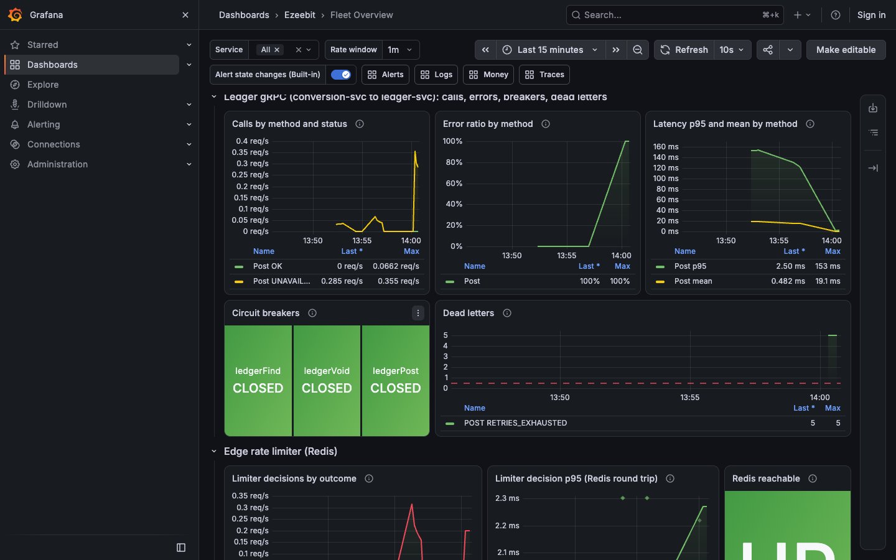

Fleet Overview, the Ledger gRPC row expanded, Last 15 minutes. Calls by method and status: "Post
UNAVAILABLE" last 0.285 req/s, max 0.355 req/s, "Post OK" 0 req/s. Error ratio by method: Post 100%.
Latency: Post p95 down to 2.50 ms, mean 0.482 ms, because a refused connection fails fast. Circuit
breakers: ledgerFind, ledgerVoid and ledgerPost all CLOSED at capture. Dead letters: POST
RETRIES_EXHAUSTED at 5.

**Proves** the row reads the gRPC client metrics and the breaker state live, and a ledger outage shows
as `UNAVAILABLE` attempts and dead letters rather than as HTTP errors. The `Post` breaker never
opened: 5 exhausted calls are below its 20-call window, as configured.

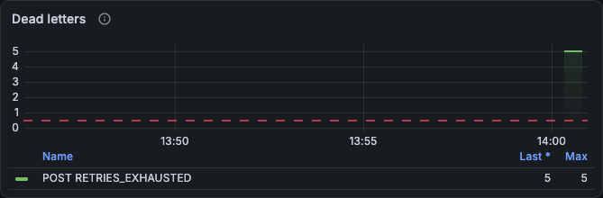

The Dead letters panel alone: one series, POST RETRIES_EXHAUSTED, steps from 0 to 5 at 14:00, above
the dashed threshold line.

**Proves** a dead letter is counted per op and reason, including the counter's first event, which
`rate()` and `increase()` cannot see.

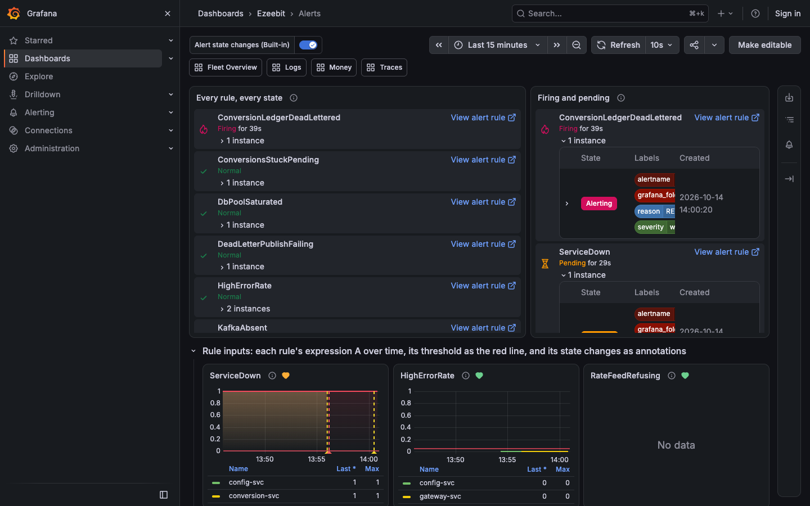

The Alerts dashboard. "Every rule, every state" lists ConversionLedgerDeadLettered "Firing for 39s",
then ConversionsStuckPending, DbPoolSaturated, DeadLetterPublishFailing and HighErrorRate Normal, and
KafkaAbsent at the bottom edge. "Firing and pending": ConversionLedgerDeadLettered, 1 instance,
Alerting, created 2026-10-14 14:00:20; ServiceDown "Pending for 29s". The ServiceDown input's
visible legend rows are config-svc and conversion-svc at 1; the rest of its legend is cut off, so the
picture cannot say which instances those series are.

**Proves** the new rule loads, evaluates and fires on the first dead letter, while ServiceDown for the
same outage is still pending.

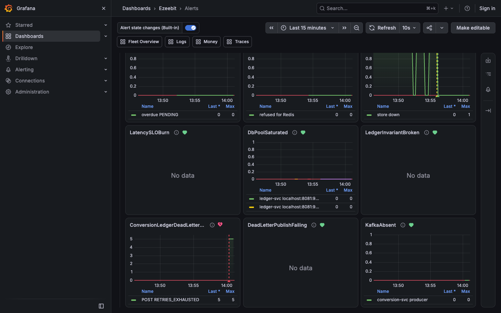

The Alerts board's rule-input grid, scrolled to the bottom row. ConversionLedgerDeadLettered: POST
RETRIES_EXHAUSTED steps to 5 with a red state-change annotation. DeadLetterPublishFailing: No data
(nothing failed to publish). KafkaAbsent: "conversion-svc producer" at 0, so the producer stayed
connected. LatencySLOBurn and LedgerInvariantBroken: No data.

**Proves** each of the three new rules has its input on the board, and the dead-letter rule's state
change is annotated on its own expression.

What this section does not prove: the restore's whole-stack bounce wiped Grafana's alert state, so
the page at t+27s never got an all-clear, and the rules re-fired once after recovery (a second page,
cleared at t+589s). That run also found the dead-letter topic deleted by the bounce; it has since
moved to the `kafkadata` volume. This outage's Slack messages were read from Grafana's notifier counter;
the channel itself is pictured under [Alerts to Slack](#alerts-to-slack) from 2026-10-16.

## Service discovery (Eureka on kind, 2026-10-16)

The Spring Eureka dashboard of the kind fleet, at release `0.3.0` (`8fd3c12`), with every scaled
service at 2 replicas:

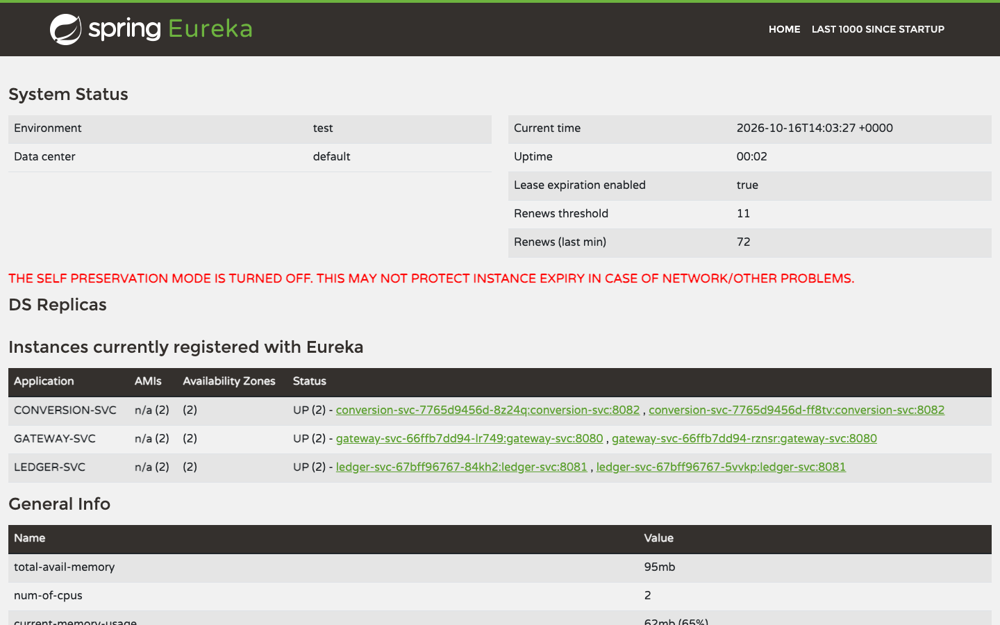

*Captured 16:03:27 SAST (14:03:27 UTC in the page's Current time).* Under "Instances currently
registered with Eureka" there are three applications, CONVERSION-SVC, GATEWAY-SVC and LEDGER-SVC,
each `UP (2)`. Each instance id is `<pod name>:<service>:<port>`, and the six pod names are the six
pods `kubectl -n ezeebit-app get pods` listed at that moment, so every replica registered itself.
config-svc and eureka-svc are not in the table: config-svc serves the Eureka settings and is not a
Eureka client, and eureka-svc does not register with itself. The red banner is expected: self
preservation is switched off on purpose, so that a killed replica leaves the registry in about 30 s
([docs/k8s.md](docs/k8s.md)). The page shows an uptime of 00:02 because the fleet had just come up.

How it was reached: eureka-svc binds its pod IP (so a killed pod's address is the one it registers),
so `kubectl port-forward`, which dials the pod's loopback, is refused. A socat ephemeral container in
the same pod bridges loopback to the pod IP; it shares the pod's network namespace, so no
NetworkPolicy is involved:

```bash
P=$(kubectl -n ezeebit-app get pod -l app.kubernetes.io/name=eureka-svc -o name | head -1)
IP=$(kubectl -n ezeebit-app get "$P" -o jsonpath='{.status.podIP}')
kubectl -n ezeebit-app debug "$P" --image=alpine/socat:1.8.0.3 --container=bridge -- \
  socat tcp-listen:18761,bind=127.0.0.1,fork,reuseaddr "tcp:$IP:8761"
kubectl -n ezeebit-app port-forward "$P" 18761:18761
```

The run printed `registered applications: 3 (want 3)`, `UP=2 want 2 PASS` for each of the three, and
`eureka capture PASS (0 mismatches)`, exit 0. Only a desktop width is captured: Eureka's own page is
not responsive, and at 390 px it crops the Status column, so a phone image would hide the evidence.

## Static application security testing (SAST)

SAST reads this repository's own code for defects without running it. Here that is SpotBugs 4.10.5
with the Find Security Bugs plugin over the compiled classes, and Checkstyle 14.3.0 over every Java
source set, both failing the build on any finding outside their filters; see
[docs/quality-gates.md](docs/quality-gates.md). At the captured commit `d538b32`, SpotBugs ran with the exclusion filter
`config/spotbugs/exclude.xml` (6 `<Match>` entries, each preceded by a comment giving its reason, as
`docs/quality-gates.md` requires), and Checkstyle with `config/checkstyle/checkstyle.xml` (2
suppressions: one limits the main-code catch rule to main sources, one exempts gateway-svc's
`RateLimitFilter`, the limiter's fail-closed line, with its reason). Both files have grown since:
from 2026-10-14 they hold 7 `<Match>` entries (the new one covers the generated gRPC code under
`io.ezeebit.contracts`) and 5 suppressions (the new three exempt `DiscoveryNameResolver`, `LedgerGuard`
and `KafkaDeadLetterPublisher`), each with its reason. "Zero findings" below means zero
outside those filters.
The architecture and coverage images below are gates from the same build, not SAST.

| Fact | Number | Universe | Command |
|---|---|---|---|
| Full gate | `BUILD SUCCESSFUL`, 86 of 86 tasks executed, 2m 57s (the shell exit code was not logged) | all 5 services, no build cache | `./gradlew --console=plain --no-build-cache --rerun-tasks clean build`; result lines in [2026-10-13-gate-summary.log](docs/evidence/security/2026-10-13-gate-summary.log) |
| SpotBugs exclusions | 6 `<Match>` entries, 6 with a reason comment | `config/spotbugs/exclude.xml` at `d538b32` | `python3 -c "import xml.etree.ElementTree as E; print(len(E.parse('config/spotbugs/exclude.xml').getroot().findall('{https://github.com/spotbugs/filter/3.0.0}Match')))"` on a checkout of `d538b32` |
| Checkstyle suppressions | 2 `SuppressionSingleFilter` modules | `config/checkstyle/checkstyle.xml` at `d538b32` | read the file at `d538b32`; both sit at its top |
| Tests | 538 passed, 0 failed, 0 errors, 0 skipped | every tier: config-svc 14, conversion-svc 210, eureka-svc 14, gateway-svc 119, ledger-svc 181 | sum of `services/*/build/test-results/*/*.xml` |
| SpotBugs findings | 0 | 222 class files: config-svc 2, conversion-svc 100, eureka-svc 2, gateway-svc 19, ledger-svc 99 | `BugInstance` count in `services/<svc>/build/reports/spotbugs/main.xml` |
| Find Security Bugs | enabled in 5 of 5, 0 analysis errors, 0 missing classes | same reports | `checkSpotbugsReport` |
| Checkstyle violations | 0 | 337 files: 204 main, 74 test, 59 acceptance test | `<error>` count in `services/<svc>/build/reports/checkstyle/*.xml` |
| Architecture tests | 13 of 13 in each service | DependencyBudgetTest 2, InjectionCounterTest 11, in all 5 services | `TEST-io.ezeebit.architecture*.xml` |

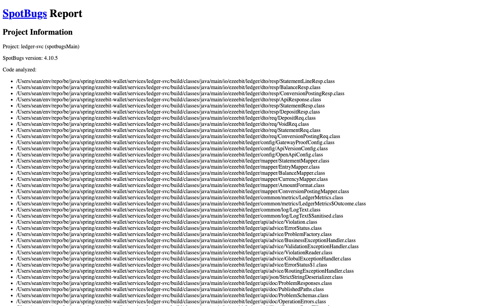

The top of the SpotBugs HyperText Markup Language (HTML) report for ledger-svc: project "ledger-svc
(spotbugsMain)", SpotBugs 4.10.5, and the start of the list of class files analysed.

**Proves** SpotBugs 4.10.5 analysed ledger-svc's compiled main classes from `build/classes/java/main`.
The HTML does not name plugins, so Find Security Bugs is shown in the all-services summary below, read
from the Extensible Markup Language (XML) report.

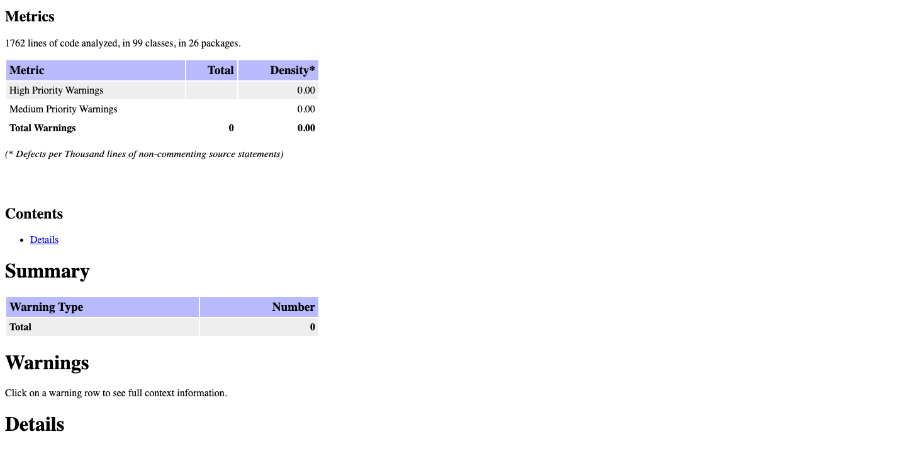

The Metrics, Summary and Warnings sections: "1762 lines of code analyzed, in 99 classes, in 26
packages", high and medium priority warnings 0, total warnings 0.

**Proves** zero SpotBugs (with Find Security Bugs) findings outside the exclusion filter over 99
analysed classes in ledger-svc.

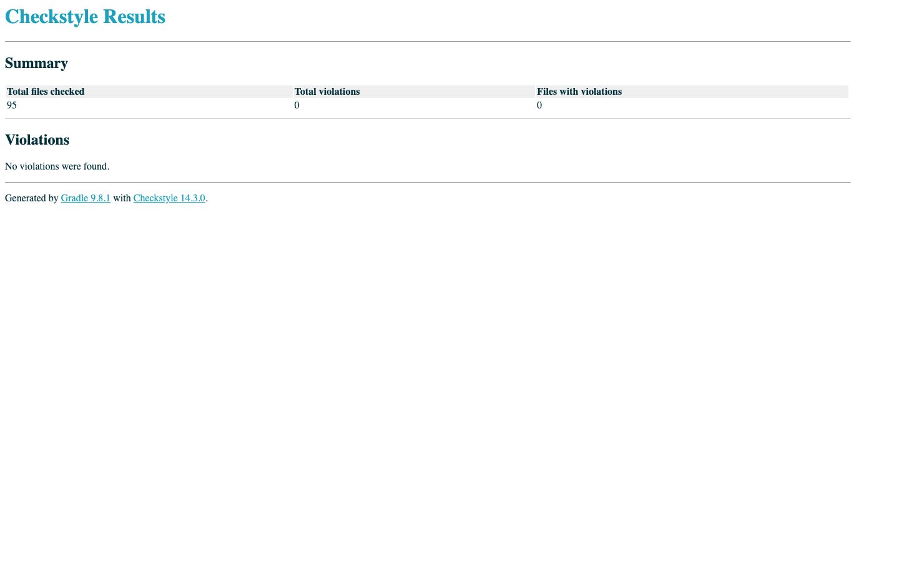

Checkstyle results for ledger-svc main: 95 files checked, 0 violations, 0 files with violations, "No
violations were found", Gradle 9.8.1 with Checkstyle 14.3.0.

**Proves** Checkstyle 14.3.0 found zero violations in ledger-svc's 95 main source files.

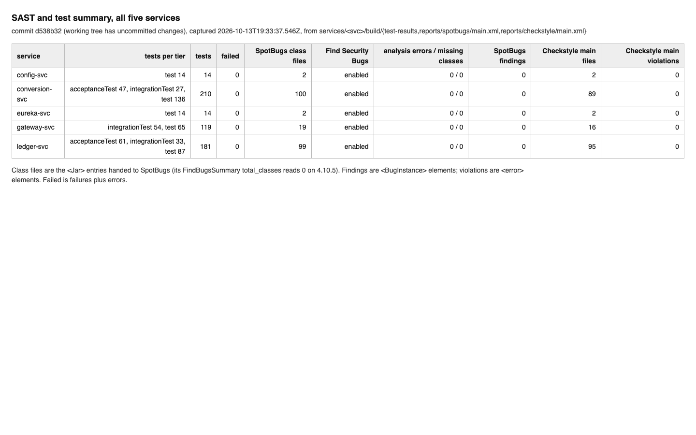

A table generated from the XML reports for all 5 services: tests per tier, failed tests, SpotBugs class
files, Find Security Bugs enabled, analysis errors and missing classes, SpotBugs findings, Checkstyle
main files and violations. Stamped with commit `d538b32` and "working tree has uncommitted changes".

**Proves** in every service Find Security Bugs is enabled, analysis errors and missing classes are 0,
SpotBugs findings are 0, Checkstyle main violations are 0 and failed tests are 0.

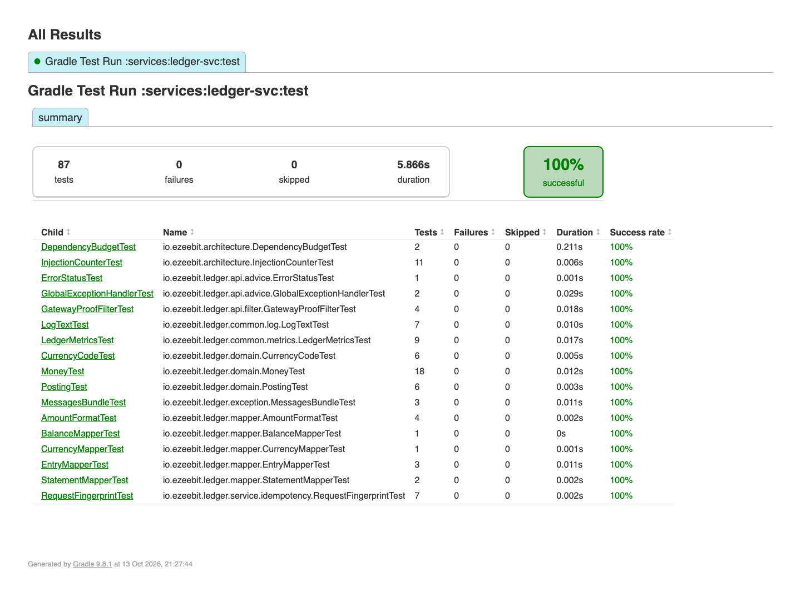

The Gradle test report for `:services:ledger-svc:test`: 87 tests, 0 failures, 0 skipped, 100%
successful, including `io.ezeebit.architecture.DependencyBudgetTest` (2) and `InjectionCounterTest`
(11).

**Proves** the dependency-injection budget gate runs inside ledger-svc's test task and passes. This is
a design rule ([docs/quality-gates.md](docs/quality-gates.md)), not SAST.

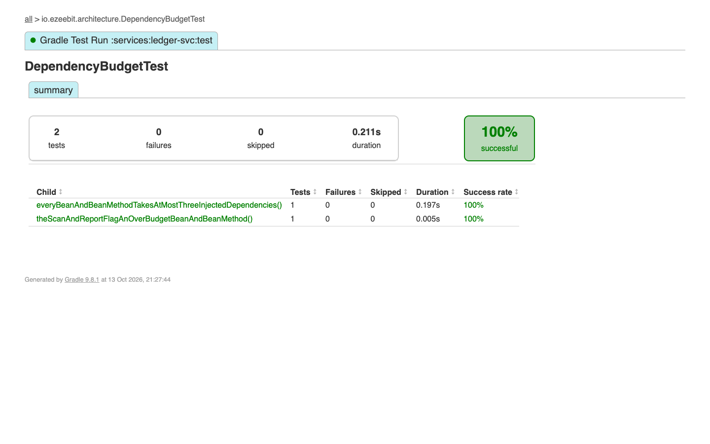

DependencyBudgetTest: 2 tests, 0 failures:
`everyBeanAndBeanMethodTakesAtMostThreeInjectedDependencies()` and
`theScanAndReportFlagAnOverBudgetBeanAndBeanMethod()`.

**Proves** every ledger-svc bean and `@Bean` method takes at most 3 injected dependencies, and an
over-budget fixture is flagged, which is the gate's negative control.

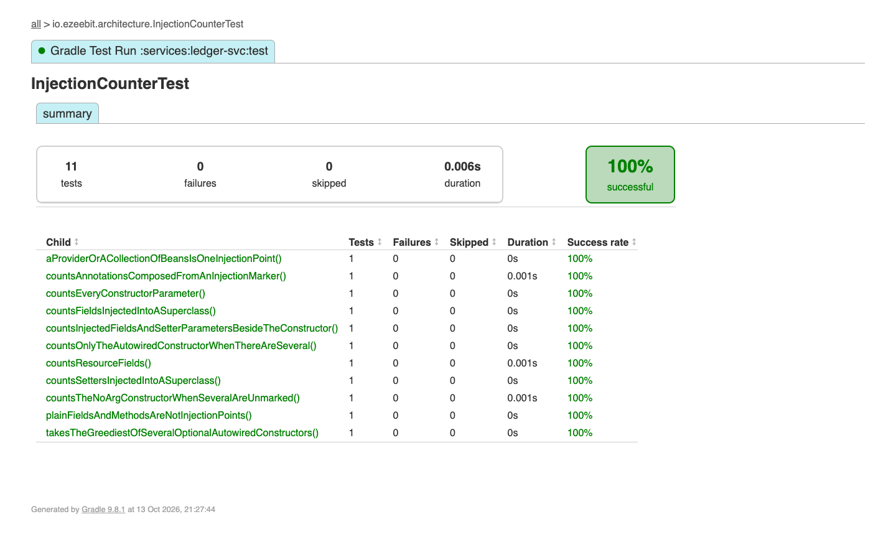

InjectionCounterTest: 11 tests, 0 failures, one per counting rule (constructor selection, fields,
setters, superclasses, `@Resource`, composed annotations, providers and collections).

**Proves** each rule the budget gate counts by is pinned by a passing fixture test.

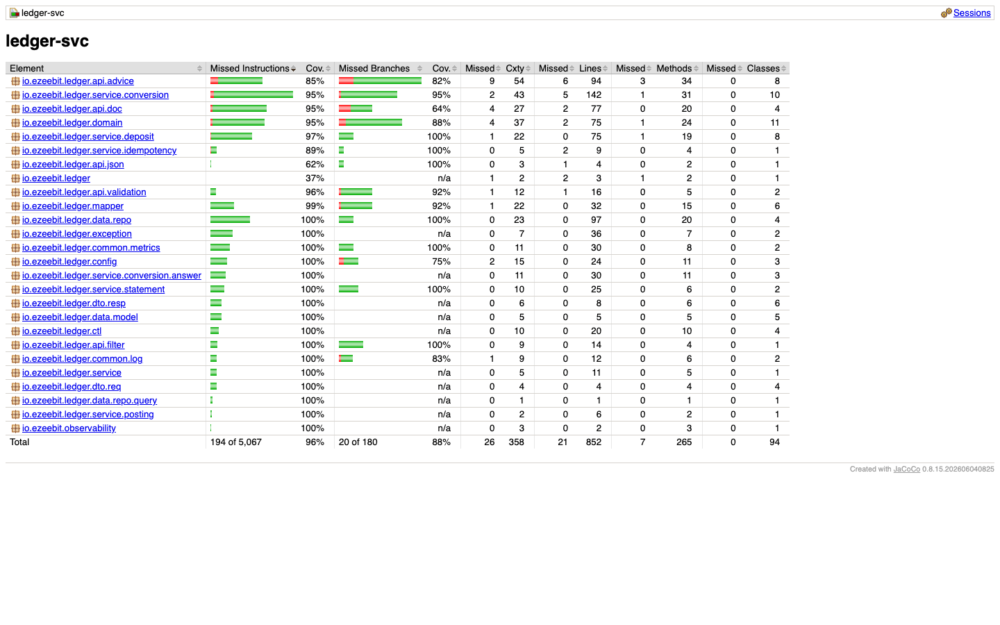

The JaCoCo 0.8.15 report for ledger-svc, merged over its tiers: instructions 194 missed of 5,067
(96%), branches 20 missed of 180 (88%), lines 21 missed of 852, 94 classes.

**Proves** ledger-svc's coverage is above its floors of 0.93 line and 0.87 branch (line 831 of 852 =
97.5%, branch 88%). This is coverage, not SAST.

## Software composition analysis (SCA)

SCA inspects what the shipped images are made of: third-party packages, the Java runtime and the jars,
checked against known vulnerabilities, plus a secrets scan of the history and the tree and one software
bill of materials (SBOM) per image. The scanners are trivy 0.74.0 and gitleaks v8.30.1, pinned by
digest in `security/scanners.lock`; see [docs/supply-chain.md](docs/supply-chain.md). The gate fails
only on a finding that is `HIGH` or `CRITICAL`, and fixable, and in a SERVICE layer (this repository's
code); SHARED layers come from the buildpack base.

| Fact | Number | Universe | Command |
|---|---|---|---|
| Gate | PASSED; every scanner exited 0 | the 14 scanner stages in [2026-10-13-supply-chain-status.txt](docs/evidence/security/2026-10-13-supply-chain-status.txt) | `./gradlew --console=plain checkSupplyChain`; console in [2026-10-13-supply-chain-console.txt](docs/evidence/security/2026-10-13-supply-chain-console.txt) |
| Images | rebuilt, `BUILD SUCCESSFUL` (the shell exit code was not logged) | 5 `ezeebit/<svc>:0.1.0` images | `./gradlew --console=plain bootBuildImageAll`; result lines in [2026-10-13-gate-summary.log](docs/evidence/security/2026-10-13-gate-summary.log) |
| Secrets | 0 | 83 of 83 commits; 432 files for gitleaks and for trivy | `checkSupplyChain` secrets stage |
| Gating image findings | 0 | 5 images | console per-image table |
| SERVICE-layer findings | 1 distinct, `MEDIUM` Common Vulnerabilities and Exposures (CVE) entry CVE-2020-13956 in httpclient 4.5.3 | 3 of 5 images | console |
| SHARED-layer findings | 47 distinct | 5 images | console |
| `CRITICAL` / `HIGH` | 0 / 9 per image, all 9 fixable and in SHARED layers | 5 images, distinct by vulnerability, package and version | trivy JavaScript Object Notation (JSON) in `build/supply-chain/images/<svc>.json` |
| SBOM components | config 177, conversion 233, eureka 232, gateway 235, ledger 233 | one CycloneDX document per image | `build/supply-chain/sbom/` |
| Misconfiguration | trivy recognised 0 of 17 files | `compose.yaml`, `docker/` and `Dockerfile*` | reported, never gating |
| Suppressions | 0 | the whole gate | console |

The trivy vulnerability database was updated at 2026-10-13T01:09:18Z.

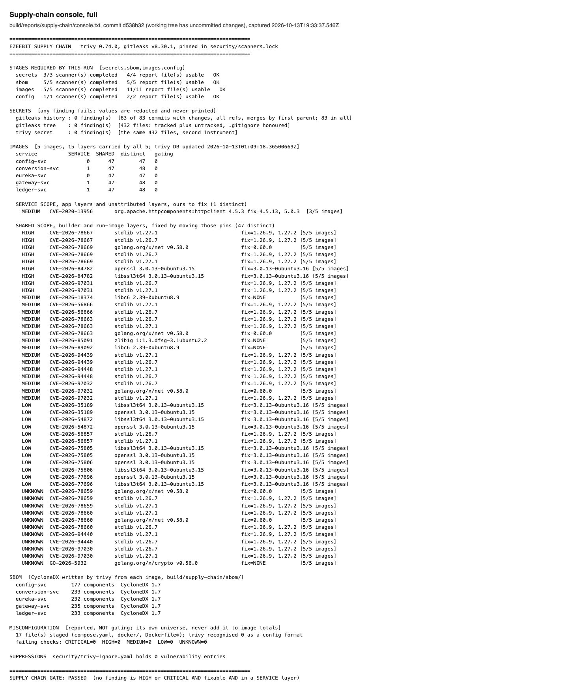

The full 90-line supply-chain console, verbatim: stages OK, secrets 0, the per-image SERVICE and SHARED
table, 1 SERVICE finding, 47 SHARED findings, SBOM component counts, misconfiguration, suppressions and
the verdict.

**Proves** `checkSupplyChain` at `d538b32` passed: 0 secrets across 83 commits and 432 files, 0 gating
image findings, 5 non-empty SBOMs, 0 suppressions.

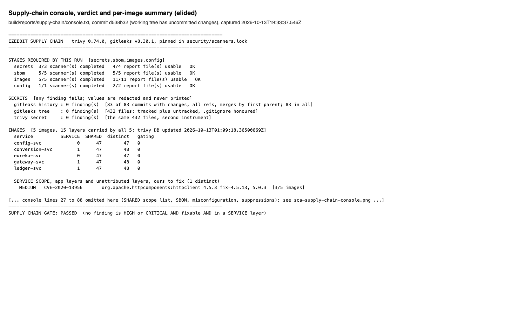

The same console with lines 27 to 88 elided behind an explicit marker: header, stages, secrets, the
per-image table, the SERVICE finding (`MEDIUM` CVE-2020-13956, httpclient 4.5.3) and the verdict line.

**Proves** the verdict and the per-image summary in one readable frame; nothing is altered except the
marked elision.

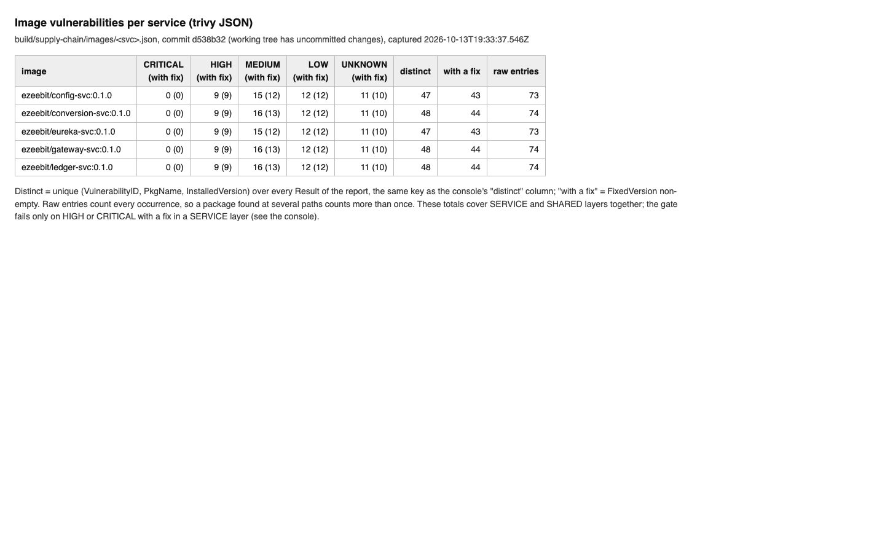

Per image, distinct vulnerabilities by severity with the fixable count in brackets. config-svc and
eureka-svc: 47 distinct (43 fixable, 73 raw entries); conversion-svc, gateway-svc and ledger-svc: 48
distinct (44 fixable, 74 raw).

**Proves** 0 `CRITICAL` in all 5 images and 9 `HIGH` in each, all fixable and all in SHARED layers per
the console; the distinct totals match the console's distinct column.

## What this evidence does not prove

- **One Slack channel is not an on-call rota.** The channel is pictured (page and all-clear, 2026-10-16,
  [Alerts to Slack](#alerts-to-slack)), but a page at night reaches a channel, not a person.
- **The 2026-10-13 and 2026-10-14 pages are not pictured in Slack.** Those runs' deliveries rest on
  Grafana's notifier counter; the channel capture is from a later outage on 2026-10-16, whose cause
  was not recorded.
- **No 2026-10-13 alert is pictured Firing.** RateFeedRefusing only reached Pending (1 minute against
  a 2-minute hold), and nothing else left Normal. The 2026-10-14 ledger outage is the one Firing
  capture (ConversionLedgerDeadLettered).
- **One laptop, one run.** Every screenshot comes from one local fleet on 2026-10-13, over a working
  tree with uncommitted changes, not a clean checkout of `d538b32`.
- **Continuous integration (CI) has never run.** No CircleCI project reads `.circleci/config.yml` yet
  ([docs/ci.md](docs/ci.md)), so none of these gates has run anywhere but this laptop.
- **A recreate of the lgtm container loses Grafana's own database.** `compose.yaml` puts
  `/data/grafana/data` on tmpfs, so every recreate (as `fleet.sh up` did at 21:03:51) drops alert
  state history and annotations. That is why the 16:23 rehearsal history is gone and only 4
  annotations exist, all after 21:04. Prometheus metrics and stored Tempo traces persist on the
  `lgtmdata` volume. Whether ServiceDown or RateLimiterStoreDown fired between 20:45 and 21:03, when
  their inputs read 1 during the `fleet.sh` sweep test, cannot be read back.
- **The first suite run crashed** (exit 1 after 6 checks): it fetched spans for gateway-svc log lines
  written before the lgtm restart, Tempo answered 404 with an empty body, and the suite's `spansOf()`
  threw on it instead of recording a failure. 32 of 173 trace ids from 20:55:27 to 20:59:29 were
  missing. The passing run waited until those lines left its 10-minute window. A run within 10 minutes
  of `fleet.sh up` will crash the same way until the suite is fixed.
- **The suite's content floor misses empty tables.** The Traces board's "Slow merchant requests" table
  rendered "No rows" (no image of it is committed, so this rests on the capturing session's
  observation), yet the suite reported 0 empty panels for that board.
- **Two images frame less than the claim.** `trace-three-services.png` cuts off the ledger-svc row
  and the `ledger posting` span. ledger-svc is confirmed by a suite check and the overview bars, and
  `ledger posting` by suite check line 6 of the run log, not by a readable label. `traces-service-map.png` was taken by a separate committed script, [2026-10-13-service-map-capture.mjs](docs/observability/verification/2026-10-13-service-map-capture.mjs), that clicked
  the map's zoom-out button once, because the default zoom clips the bottom row of nodes.
- **A cosmetic dashboard defect.** The Money board's "Ledger posting p95" axis labels read 40.824562 ms,
  40.82456 ms, 40.824558 ms, because a near-flat series auto-scales to microsecond precision.
- **Zero findings is not a red-proof.** The SpotBugs and Checkstyle reports show a clean result, not
  that the detectors fire; no planted defect was run through them for this capture.
- **Only ledger-svc's HTML reports are pictured.** The other four services appear only in the summary
  table.
- **The SpotBugs XML reads `total_classes="0"`** for every service on 4.10.5. The build counts the
  class files handed to the analyser instead; a reader of `main.xml` alone could misread it as nothing
  analysed.
- **The severity table does not split layers.** It counts SERVICE and SHARED together; the layer split
  comes only from the console.
- **The scanned images are not what produced the monitoring evidence.** `fleet.sh` runs each service
  as a JVM from its `bootJar` on the host (`java -jar services/<svc>/build/libs/...`); it never runs
  the `ezeebit/<svc>:0.1.0` images scanned on 2026-10-13. Those images were what would ship at the
  time, and `bootBuildImageAll` built them only for the supply-chain scan. Release `0.2.0` has since
  shipped (2026-10-15); its images were not scanned for this evidence. The SCA verdict covers the images; the monitoring evidence
  covers the host jars.
