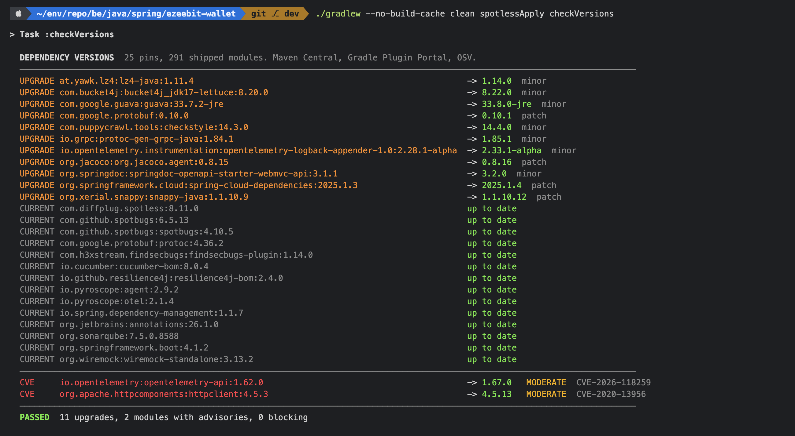
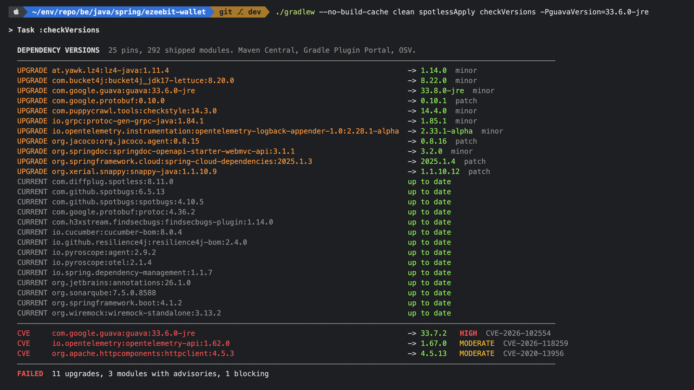

# Supply-chain gate

Back to [README](../README.md). Static analysis of this repository's own code is in
[quality-gates.md](quality-gates.md).

Three Gradle tasks, split by cost. `checkSecrets` and `checkSupplyChain` run the scanners as containers pinned by tag and
digest in `security/scanners.lock`, the only place a scanner version lives. `checkVersions` is a script that asks Maven Central,
the Gradle Plugin Portal and OSV directly.

`checkSupplyChain` and `checkVersions` are the two software composition analysis (SCA) checks: the first reads the built images,
the second reads the Maven modules before an image exists. `spotlessApply` also appears below and is not SCA: it formats this
repository's own source, and its `noNestedDiCalls` step is a readability rule on that source.

| Task | Runs in | Reads | Needs |
|---|---|---|---|
| `checkSecrets` | every `./gradlew build` (root `check`) | the git history and the working tree | Docker; no images |
| `checkSupplyChain` | only when asked | secrets again, then the five images, their software bills of materials (SBOMs) and the compose and docker files | `bootBuildImageAll`, which it depends on |
| `checkVersions` | only when asked | every `*Version` pin against Maven Central and the Gradle Plugin Portal; every module on the services' runtime classpaths against OSV | network; no Docker, no images |

`checkVersions` prints `UPGRADE` for a pin with a newer release on its own line (a release pin is never offered a
pre-release, a `-jre` pin never `-android`), and `CVE` for a module with an advisory, with the highest first fix
across its advisories or `No Upgrades`. It fails, exit 3, on any one advisory with a fix on a shipped module that is
HIGH, CRITICAL or carries no severity, a stricter form of the `checkSupplyChain` test applied before an image exists.
An unreachable source is exit 2, never a pass. It does not read the image pins in `gradle.properties`, the operating
system, the JRE, or classes shaded inside a jar (the Pyroscope agent vendors protobuf, kotlin and okhttp under its own
package, with no coordinates for OSV to match). `checkSupplyChain` reads the first three; whether it sees shaded classes
is unverified.
`gradle/version-report.gradle` holds no list of artifacts: it reads each pin's coordinate from the build files
(a `group:artifact:${xVersion}` string, a plugin `id ... version`, or a `toolVersion` and the configuration its plugin
fills), and `testVersionReport`, in `check`, fails when a `*Version` property has none of those. Colour is off under `--console=plain`, `NO_COLOR`, `CI` or `TERM=dumb`;
`build/reports/versions/report.txt` is always plain.



The same run with an old Guava forced in by `-PguavaVersion=33.6.0-jre`: one HIGH advisory with a fix, so the task fails.



```sh
./gradlew spotlessApply                      # fix formatting first; spotlessCheck in check fails otherwise
./gradlew checkVersions                      # pins and advisories; -P<xVersion>=<v> tries a version without editing
./gradlew bootBuildImageAll                  # ezeebit/<svc>:0.5.0, one per service, Paketo only
./gradlew bootBuildImageAll checkSupplyChain
cat build/reports/supply-chain/console.txt   # the console text, saved as printed
```

Images come from Spring Boot's `bootBuildImage` with `BP_JVM_VERSION=25`, and the image appends
`-XX:+UseCompactObjectHeaders -XX:+UseG1GC` to `JAVA_TOOL_OPTIONS` at launch (Java 27's defaults,
JEP 534 and JEP 523). Without the flag, a 1Gi pod sits under the JVM's 1792MB server-class line and
ergonomics picks SerialGC; measured on the 0.3.2 image, 2026-11-04. The Paketo builder and
its run image are both pinned by tag and digest in `gradle.properties` (`paketoBuilder`,
`paketoRunImage`). The repository has no Dockerfile. Images are built for the Docker daemon's
architecture.

## What each stage does

| Stage | Instrument | Universe |
|---|---|---|
| secrets | gitleaks `git --log-opts="--all --diff-merges=first-parent"` | every commit reachable from any ref, merges included as their diff against the first parent; the console prints the commits gitleaks scanned beside the commits git counts, and a mismatch fails |
| secrets | gitleaks `dir`, then trivy `fs --scanners secret` | tracked files plus untracked files that `.gitignore` does not exclude, copied out first, so `.env` never reaches a scanner |
| images | trivy `image --input` on a `docker save` tarball | the operating-system packages, Java Runtime Environment (JRE), buildpack helpers and jars in each image; the scanner gets no Docker socket |
| sbom | trivy `--format cyclonedx` from the same tarball | one CycloneDX document per image in `build/supply-chain/sbom/` |
| config | trivy `config` | `compose.yaml`, `docker/` and any tracked `Dockerfile*`; reported, never gating |

Both image scans skip `layers/sbom`, where Paketo stores SBOM documents describing packages that
already sit in other layers. Read as a second source, they put the buildpack launcher into a layer
that differs per image and so made it look like this repository's code.

## Reading the console

1. **Stages required by this run.** One line per stage: scanners that recorded a completing exit
   code, and report files present, non-empty and parseable. Anything short of that is `MISSING` and
   fails the gate: a scanner that never ran must not read as one that found nothing.
2. **Secrets.** Findings per instrument, as rule, file and line. Values are redacted (`--redact`
   for gitleaks; trivy masks them) and the console never prints one. Any finding fails.
3. **Images.** `N images, M layers carried by all N`, then per service the distinct findings in
   SERVICE layers and in SHARED layers, and how many of them gate. Layers are attributed by who
   built them, read from each image's `io.buildpacks.lifecycle.metadata` label. SHARED is the run
   image's layers and the buildpack and launcher layers: their findings move when the builder or
   run-image pin moves, so they are reported, not gated. SERVICE is every `app` layer (the
   application and its jars), plus any layer the label does not name, so an unattributed layer
   fails safe.
4. **SBOM.** Component count per image; 0 components fails.
5. **Misconfiguration.** Checks against files, never vulnerabilities in an image, so its totals
   must not be added to the image totals.
6. **Suppressions**, then the verdict.

**The verdict is a three-clause test.** `checkSupplyChain` fails only on a finding that is HIGH or
CRITICAL **and** has a published fix **and** sits in a SERVICE layer. Everything else is reported.
`security/trivy-ignore.yaml` has no vulnerability entries. It is read in block form only (`- id:`,
`statement:`, `expired_at:`); flow style, an empty `statement`, a date not in International Organization for Standardization (ISO) 8601 form, or an expired date
fails the gate.

**Evidence goes stale on every new commit.** Re-run `checkSupplyChain` after any change rather than
quoting an older console.

## State

Latest recorded verdict, release 0.5.0: PASSED on 2026-11-09 on `rel-0.5.0` at `4bd8ce5` with the builder pin moved to
0.0.203 (the newest tag at least two weeks old that day), 5 of 5 images scanned, trivy database
2026-11-09T13:58Z, nothing suppressed. On 0.0.198 there were 24 distinct SHARED findings, 7 of them HIGH rows; on 0.0.203
there are 5, 2 of them HIGH. **0.5.0 still ships two fixable HIGH findings in the SHARED layers**, in the builder's helper
binaries on all 5 images: Go `stdlib` 1.27.2 (CVE-2026-111943, fixed in 1.27.3) and `golang.org/x/net` 0.61.0
(CVE-2026-78661, fixed in 0.62.0). No builder clears them under the pin rule yet. The SERVICE layers carry the same two
MEDIUM findings as 0.4.0, neither gating.

Previous verdict, release 0.4.0: PASSED on 2026-11-05 on `rel-0.4.0` with the builder pin moved to
0.0.198 (the newest tag at least two weeks old that day), 5 of 5 images scanned, trivy database
2026-11-05T13:09Z, nothing suppressed. The same gate on builder 0.0.197 also passed, with 39 distinct SHARED
findings, 9 of them HIGH rows; on 0.0.198 there are 26, 6 of them HIGH. **0.4.0 still ships fixable HIGH
findings in the SHARED layers**, in the builder's helper binaries on all 5 images: Go `stdlib` 1.27.1 and
1.27.2 (CVE-2026-111943, CVE-2026-78667, CVE-2026-78669, CVE-2026-97031) and `golang.org/x/net` 0.59.0
(CVE-2026-78669). No builder clears them under the pin rule yet; the next bump past 0.0.198 is the fix. The
SERVICE layers carry two MEDIUM findings, neither gating: httpclient 4.5.3 (CVE-2020-13956, 3 of 5 images) and
opentelemetry-api 1.62.0 (CVE-2026-118259, 5 of 5).

Previous verdict, release 0.3.2: PASSED on 2026-11-04 at `1945363`, 5 of 5 images scanned, trivy
database 2026-11-04T07:16Z, nothing suppressed. The run before it, on `365e3d6`, failed on three HIGH, fixable
SERVICE findings published after 0.3.1: CVE-2026-102554 (guava 33.6.0 via grpc-java, 33.0.0-jre via the Eureka
server) and CVE-2026-108106 and CVE-2026-93451 (snappy-java 1.1.10.7 via kafka-clients 4.2.1). Commit `2eda9a4`
pins guava 33.7.2-jre and snappy-java 1.1.10.9; neither run's console was committed.

**0.3.2 ships with fixable HIGH findings in the SHARED layers**, in buildpack helper binaries of the builder
pin (all 5 images): Go `stdlib` 1.26.8 and 1.27.1 (CVE-2026-111943, CVE-2026-78667, CVE-2026-78669,
CVE-2026-97031) and `golang.org/x/net` 0.58.0 (CVE-2026-78669). They are not fixed here because no builder
clears them under the pin rule: the newest builder tag at least two weeks old on 2026-11-04 is 0.0.197, the
current pin (0.0.198 was pushed 2026-10-22). Moving the builder pin past 0.0.197 is the fix for the next patch.

Previous verdict: PASSED on 2026-10-15, 5 of 5 images scanned, trivy database 2026-10-15T07:10Z,
after the run before it failed on one HIGH, fixable SERVICE finding: CVE-2026-106451 in lz4-java 1.10.1,
pulled into conversion-svc by kafka-clients 4.2.1. Commit `65f9d0c` pins lz4-java 1.11.4 and records
both results in its message; that run's console and status file were not committed.

The last run with committed evidence: PASSED, nothing suppressed: `SUPPLY CHAIN GATE: PASSED`, re-run on 2026-10-13 at commit `d538b32` after
`bootBuildImageAll` rebuilt all 5 images, with the trivy database updated 2026-10-13T01:09:18Z. Its console and
per-scanner exit codes are committed as [2026-10-13-supply-chain-console.txt](evidence/security/2026-10-13-supply-chain-console.txt)
and [2026-10-13-supply-chain-status.txt](evidence/security/2026-10-13-supply-chain-status.txt). The first run failed on nine Common Vulnerabilities and Exposures (CVE) entries in jars Spring Boot 4.1.1 manages. They are cleared by patch overrides
of Boot's own properties in the root `build.gradle` (`tomcat.version`, `jackson-bom.version`,
`jackson-2-bom.version`, `freemarker.version`), each pinned in `gradle.properties`: Tomcat 11.0.26,
Jackson 3.1.7 and 2.21.7, FreeMarker 2.3.35 (the Eureka dashboard renders with it, so it is
overridden, not excluded). Each override must be dropped once Boot manages that version or newer.
All four were dropped on 2026-11-04 with the bump to Boot 4.1.2, which manages Tomcat 11.0.27, Jackson
3.1.7 and 2.21.7, and FreeMarker 2.3.35 (spring-boot-dependencies-4.1.2.pom).
Since 2026-10-15 conversion-svc also pins lz4-java 1.11.4 (`lz4JavaVersion` in `gradle.properties`,
a dependency constraint in its `build.gradle`) for CVE-2026-106451. It is a transitive override of
kafka-clients 4.2.2 (which brings lz4 1.11.2), not a Boot property, and must be dropped once Boot manages a kafka-clients that brings a fixed lz4.

Two SERVICE findings remain and do not gate: `httpclient` 4.5.3, MEDIUM, via the Eureka client, in 3 of the 5 images;
and `opentelemetry-api` 1.62.0, CVE-2026-118259, MEDIUM, fixed in 1.67.0, in 5 of the 5 images (supply-chain run of
2026-11-05, `docs/k8s/verification/2026-11-05-profiling-gates-supplychain.log`). The second arrives through
`spring-boot-starter-opentelemetry` at Boot's managed `opentelemetry.version` (1.62.0 in Boot 4.1.1 and 4.1.2), so it
predates the profiling branch. It is parked for Sean and not bumped: `otelLogbackAppenderVersion` in
`gradle.properties` must match Boot's opentelemetry-api.
The SHARED HIGH findings (OpenSSL in the run image, Go `stdlib` and `x/net` in buildpack helpers)
belong to the builder and run-image pins. trivy has no compose checks, so the misconfiguration stage
recognises none of the files it reads and reports zero checks rather than a clean bill.

## Re-rendering the verdict without rescanning

Reports land in `build/supply-chain/` (one JavaScript Object Notation (JSON) file per scanner plus `status.txt`, one exit code per
scanner):

```sh
SERVICES="config-svc conversion-svc eureka-svc gateway-svc ledger-svc" IMAGE_VERSION=0.5.0 \
  OUT_DIR=build/supply-chain CONSOLE_FILE=build/reports/supply-chain/console.txt \
  ./security/scan.sh gate secrets,sbom,images,config
```

For secrets, gitleaks reads git objects and trivy reads files, so the history is the half trivy
cannot see. That is why both run.
